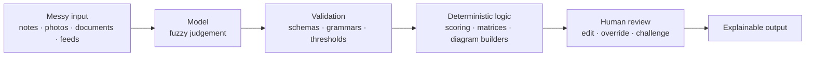

# Portfolio Deep Dives

Technical deep dives into products I have designed and built. Each page explains **how the solution works**: the architecture, the key design decisions and the trade-offs.

I am a Product and Technology Leader who still builds. I keep building because it keeps my product decisions grounded in what is actually possible, not just what looks good on a roadmap. These pages are the engineering side of that work.

> **The code is private.** These pages document design and engineering decisions, not source code.
> For the business view of each project (the problem, the solution and the results), see my [portfolio](https://filbezerianos.com/portfolio/).

# Projects

Some of these came from patterns I have seen in enterprise product work, others from curiosity about what is possible with emerging technology. The "Where it went" column says how far each one travelled.

| Project | What it does | Core idea | Where it went | My role |
|---|---|---|---|---|
| [**Product Work Focus Tool**](projects/product-work-focus-tool-technical-deep-dive.md) | Prioritises product work against a strategy and generates an indicative delivery plan | LLM as a constrained classifier inside a deterministic, PM-controlled framework | Up to 50% faster prioritisation in early testing. Became the foundation of an AI product platform at work | Technical Lead and Product Manager |
| [**AI Cloud Migrator**](projects/ai-cloud-migrator-technical-deep-dive.md) | Recommends a cloud migration strategy per application, aligned to the organisation's goals | Deterministic rules first, a constrained LLM for the grey areas, then a transparent scoring layer | In use with consulting organisations. 60% shorter assessment phase, 50% fewer resources | Product Manager and AI/Technical Lead, leading an engineer and a cloud architect |
| [**Relationships Mapping Visualiser**](projects/relationships-maping-visualiser-technical-deep-dive.md) | Turns unstructured interview notes into an editable diagram of how teams and tools interact | The LLM extracts; strict validation and code build the diagram; a human fixes the rest | In use in client engagements. 80% less time creating the diagram, 15% less overall assessment time | Sole builder |
| [**Property Visual Finder**](projects/property-visual-finder-technical-deep-dive.md) | Scores property listings from their photos so they can be filtered and ranked by visual features | Closed-question visual analysis, with certainty-aware aggregation across 330k+ images | Integrated into a UK agency's system. 17% less time on mismatched properties | Product Manager and AI/Technical Lead, leading two engineers |
| [**News Titles Shift**](projects/news-titles-shift-technical-deep-dive.md) | Rewrites live headlines for a reader profile, then shows exactly how it did it | Make persuasion legible: manipulated, neutral and annotated versions side by side | An experiment. A working demonstration of personalised persuasion | Sole builder |
| [**Agents Duo**](projects/agents-duo-technical-deep-dive.md) | Two language models hold an open-ended conversation with configurable personalities | A small, well-instrumented harness for studying model-to-model interaction | An experiment. Observations on style drift and self-directed topics | Sole builder |

# Principles I build by

The projects solve different problems, but the same principles keep showing up. AI makes them matter more, because a model's output is never guaranteed.

**1. Put judgement where it's cheap to be wrong, and rules where it isn't.**
Models read messy text and images. Scores, priorities, diagrams and plans come from plain, testable code, so the same inputs always produce the same answer.

**2. Constrain what comes out.**
Schemas, grammars, thresholds and closed question sets box in every model call. Invalid output is dropped or flagged, never trusted.

**3. Keep a human in control where decisions matter.**
Everything can be edited, and edits go through the same code path as automated output. If correcting a mistake is slower than doing it by hand, the tool has failed.

**4. Make reasoning visible.**
Rationales and evidence sit next to every result, so a person can challenge it, not just accept it.

**5. Keep sensitive data close.**
Strategy documents, psychological profiles, client interview notes and application inventories are exactly what organisations don't want to send to a third party. Most of these tools can run entirely on local models.

**6. Be honest about uncertainty and limits.**
Every page ends with known limitations and a roadmap, and where I haven't measured something, I say so.

In the AI projects, these principles shape one recurring pattern:

# How each page is structured

Every page explains how the thing works and why I made the choices I did. The sections that matter depend on the project, but most pages draw on these:

- **The problem in engineering terms**: what has to be solved beyond the business need
- **Architecture**: components, data flow and stack
- **Key design decisions**: the interesting parts, with the reasoning
- **Trade-offs**: what each choice costs
- **Known limitations and roadmap**: what's missing and what comes next
- **Results and my role**: with a link back to the business case study

Not every project has every section. An experiment may have no results to report, and a small tool may have no architecture worth a section of its own. Where a section would be empty, I leave it out rather than pad it.

# What isn't here

- No source code, client data, credentials or complete production prompts. Where prompts matter, I describe their structure and design rather than publish them.
- No claims I can't support. Figures are reported results from the engagements described, and anything exploratory is labelled as such.

# Find out more

- Business case studies for each project: [filbezerianos.com/portfolio](https://filbezerianos.com/portfolio/)
- My writing and background: [filbezerianos.com](https://filbezerianos.com)
- Let's connect: [LinkedIn](https://www.linkedin.com/in/filbezerianos/)
