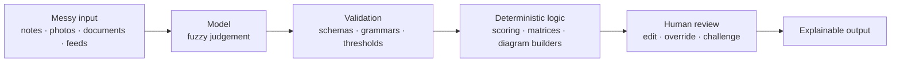

# Portfolio Deep Dives

Deep dives into AI-powered products I've designed and built. Each page explains **how the solution works**: the architecture, the key design decisions, the trade-offs, and what I'd do next.

> **The code is private.** These pages document design and engineering decisions, not source code.
> For the business view of each project (the problem, the solution and the results), see my [portfolio](https://filbezerianos.com/portfolio/).

---

## Projects

### Used in real engagements

| Project | What it does | Core idea | Reported results | My role |
|---|---|---|---|---|
| [**AI Cloud Migrator**](projects/ai-cloud-migrator-technical-deep-dive.md) | Recommends a cloud migration strategy per application, aligned to the organisation's goals | Deterministic rules first, a constrained LLM for the grey areas, then a transparent scoring layer | 60% shorter assessment phase, 50% fewer resources | Product Manager and AI/Technical Lead, leading an engineer and a cloud architect |
| [**Property Visual Finder**](projects/property-visual-finder-technical-deep-dive.md) | Scores property listings from their photos so they can be filtered and ranked by visual features | Closed-question visual analysis, with certainty-aware aggregation across 330k+ images | 17% less time on mismatched properties (UK agency) | Product Manager and AI/Technical Lead, leading two engineers |
| [**Relationships Mapping Visualiser**](projects/relationships-maping-visualiser-technical-deep-dive.md) | Turns unstructured interview notes into an editable diagram of how teams and tools interact | The LLM extracts; strict validation and code build the diagram; a human fixes the rest | 80% less time creating the diagram, 15% less overall assessment time | Sole builder |

### Experiments and research

| Project | What it does | Core idea | Outcome | My role |
|---|---|---|---|---|
| [**Product Work Focus Tool**](projects/product-work-focus-tool-technical-deep-dive.md) | Prioritises product work against a strategy and generates an indicative delivery plan | LLM as a constrained classifier inside a deterministic, PM-controlled framework | Up to 50% faster prioritisation in early testing; became the foundation of an AI product platform at work | Technical Lead and Product Manager |
| [**News Titles Shift**](projects/news-titles-shift-technical-deep-dive.md) | Rewrites live headlines for a reader profile, then shows exactly how it did it | Make persuasion legible: manipulated, neutral and annotated versions side by side | A working demonstration of personalised persuasion | Sole builder |
| [**Agents Duo**](projects/agents-duo-technical-deep-dive.md) | Two language models hold an open-ended conversation with configurable personalities | A small, well-instrumented harness for studying model-to-model interaction | Observations on style drift and self-directed topics | Sole builder |

---

## The thread running through them

The projects solve different problems, but the same design principles keep showing up.

**1. Use the model for judgement, and code for anything that must be correct.**
Models read messy text and images. Scores, priorities, diagrams and plans come from plain, testable code. A priority is a lookup table, not a prediction, so the same inputs always produce the same answer.

**2. Constrain the output.**
Every model call is boxed in: Pydantic schemas, JSON-schema-constrained responses, a strict line grammar checked by regex, closed question sets. Invalid output is dropped or flagged, never trusted.

**3. Keep a human in control where decisions matter.**
Strategies, dimensions, relationships and scores can all be edited, and edits go through the same code path as AI output. If correcting a mistake is slower than doing it by hand, the tool has failed.

**4. Make reasoning visible.**
Rationales next to every assessment, technique breakdowns traced to profile signals, certainty scores stored with their evidence counts. The aim is output a person can challenge, not just accept.

**5. Keep sensitive data local.**
Strategy documents, psychological profiles, client interview notes and application inventories are exactly what organisations don't want to send to a third party. Most of these tools can run entirely on local models.

**6. Be honest about uncertainty and limits.**
Every page ends with known limitations and a roadmap, and where I haven't measured something, I say so.

---

## How each page is structured

1. **The problem in engineering terms**: what has to be solved beyond the business need
2. **Architecture**: components, data flow and stack
3. **Key design decisions**: the interesting parts, with the reasoning
4. **Trade-offs**: what each choice costs
5. **Known limitations and roadmap**: what's missing and what comes next
6. **Results and my role**: with a link back to the business case study

---

## What isn't here

- No source code, client data, credentials or complete production prompts. Where prompts matter, I describe their structure and design rather than publish them.
- No claims I can't support. Figures are reported results from the engagements described, and anything exploratory is labelled as such.

---

## About

I'm Fil Bezerianos, a product manager and technical lead working on practical applications of AI. These projects span consulting, real estate, product management and research.

- Website: [filbezerianos.com](https://filbezerianos.com)
- LinkedIn: [filbezerianos](https://www.linkedin.com/in/filbezerianos/)

© Fil Bezerianos. All rights reserved. The content of this repository is documentation only and is not licensed for reuse.