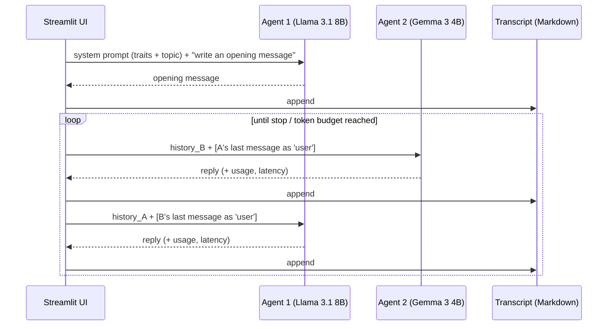

# Agents Duo: Technical Deep Dive

> A local-first experiment in which two language models hold an open-ended conversation with each other. Each agent has a configurable personality, and no human steers the dialogue after the setup. A live monitor shows per-turn latency, token usage and effective temperature, and every conversation is saved for replay. **Source code is private.** This page documents the architecture and design decisions. [The idea and what I observed on filbezerianos.com](https://filbezerianos.com/portfolio/agents-duo/)

    

# What this is, in engineering terms

Almost all LLM applications are human ↔ model. This one removes the human from the loop after setup, which raises a small but interesting set of design problems:

1. How do you make two models **talk to each other** using an API built for human ↔ assistant chat?
2. How do you give each side a **distinct, controllable personality** with a few intuitive controls?
3. How do you keep an **unbounded conversation** within a finite context window?
4. How do you make the run **observable and replayable**, so it works as an experiment and not just a demo?

# Architecture



| Layer | Choice |
|---|---|
| Inference | Two open-weight models served locally by LM Studio through its OpenAI-compatible endpoint |
| Client | Standard `openai` SDK pointed at a local base URL; no API key, no cloud calls |
| UI | Streamlit multipage app: chat, bot configuration, chat history viewer |
| Persistence | One timestamped Markdown transcript per run, appended after every turn |
| Dependencies | Two packages (`streamlit`, `openai`) |

# Making two models talk: mirrored roles

Chat APIs assume a human in the `user` role. The trick is to **make each agent see the other as its user**:

- Each agent keeps its **own message history**, never a shared one.
- Its own earlier messages are `assistant` turns; the other agent's messages are `user` turns.
- Each agent has its **own system prompt**: personality, name and behaviour guidelines.

Seen from either side, the conversation looks like a normal human chat, so no model-specific handling is needed and any chat-tuned model can take either seat. The same code works for any pair of models served behind the same API.

The conversation is strictly **turn-based and synchronous**, one request at a time. This keeps the logic trivial and the transcript ordering deterministic.

# Personality as a controlled input

Five traits, each with five levels:

| Trait | Levels (1 → 5) |
|---|---|
| Creativity | Literal · Grounded · Balanced · Inventive · Wildly Creative |
| Humour | Serious · Dry · Witty · Funny · Goofy |
| Confidence | Hesitant · Cautious · Balanced · Assertive · Overconfident |
| Politeness | Blunt · Casual · Neutral · Polite · Excessively Courteous |
| Formality | Slangy · Informal · Standard · Professional · Academic |

Each level is a **named behaviour description** that is injected into the agent's system prompt. Sliders are the whole interface, and prompts are never edited by hand, so personalities are reproducible and comparable.

## Traits also move the sampling temperature
Three of the five traits are expressive in a way that sampling temperature reinforces. They are combined into one effective temperature:

```text
raw  = (0.40·creativity + 0.20·humour + 0.15·confidence) / 0.75      # 1…5
temp = 0.2 + (raw − 1) / 4                                            # 0.2…1.2
```

| Setting | Effective temperature |
|---|---|
| All traits = 1 | 0.2 |
| All traits = 2 (default) | 0.45 |
| All traits = 3 | 0.7 |
| Creativity 5, humour 1, confidence 3 | 0.83 |
| All traits = 5 | 1.2 |

Politeness and formality change only the prompt. The result is that a personality is expressed through **two channels at once**: what the model is told to be (prompt) and how adventurous it is allowed to be (sampling). The effective temperature of each bot is shown live in the UI.

# Starting the conversation

- **Topic.** The user picks from a small curated set or chooses `Random`, which tells the agent to pick a subject that suits its own traits.
- **Opening message.** Agent 1 produces it in a separate call that is instructed not to mention the topic or the fact that it's an opening. This avoids the stilted "Let's talk about X" start.
- **Asymmetric information.** Only Agent 1 is given the topic. Agent 2 discovers it from the first message, as a human conversation partner would.

# Running unbounded conversations safely

- **Context accounting.** Each agent's history grows every turn. After each call, the response's token usage is compared with a configured budget, and the run ends cleanly when either agent exceeds it.
- **Live monitor.** A progress bar per agent shows context utilisation, along with the current effective temperature.
- **Latency per turn.** Each message shows its generation time, which makes the cost of long histories on small local models visible.
- **Control.** Start, stop-and-refresh and configure are always available; Streamlit's rerun model interrupts the blocking loop when a control is used.

# Persistence and replay

- A transcript is created on start and **appended after every message**, so nothing is lost if a run is interrupted.
- The sidebar lists past runs; selecting one opens it in a read-only viewer.
- Plain Markdown makes transcripts easy to read, grep and diff.

# Local-first by design

- Both models run on the same machine through LM Studio; there is no per-token cost and nothing leaves the machine.
- Because the API surface is the standard chat-completions interface, switching models or pointing at a hosted endpoint is a configuration change.
- It makes long, expensive-by-default experiments (hundreds of turns) practical.

# Observations, and how I'd test them properly

The experiment was exploratory, not controlled. The two things I noticed:

**1. Style drift between agents.** Over long runs, one agent's tone began to track the other's. In one saved run, a formal agent that started with almost no exclamation marks or emoji ended up using about a dozen exclamation marks and ten emoji per message, matching its partner.

A plausible mechanism, not a proven one:
- each agent receives the other's messages as *user* turns, and chat-tuned models tend to adapt to the register of the person they are talking to;
- as the history grows, the fixed system prompt becomes a smaller part of the context, so the conversation's own style outweighs the instructions.

How to test it:
- swap the models' seats and starting order;
- re-inject the personality prompt periodically, or cap the history with a sliding window, and see whether drift disappears;
- measure drift with simple style metrics per turn (sentence length, exclamation and emoji rate, formality) plus embedding similarity between the two agents' messages.

**2. Self-directed topics.** With `Random`, conversations built on earlier threads, changed register and sometimes returned to previous ideas. This is consistent with each agent conditioning on a full, growing history; whether it counts as "agency" is a philosophical question that the experiment doesn't settle.

# Engineering trade-offs

| Decision | Why | Cost |
|---|---|---|
| Mirrored roles with separate histories | Works with any chat model, no special handling | Doubles the stored context; each bot only sees its own view |
| Synchronous turn loop | Simple and deterministic | No streaming; the UI is blocked per turn |
| Traits drive both prompt and temperature | Personality shows in tone *and* variability | Temperature couples three traits; hard to isolate their effects |
| Token budget as the stop condition | Prevents context overflow on small models | Ends runs by resource limits, not by conversational convergence |
| Markdown transcripts | Human-readable, zero infrastructure | Easy to read but not easy to query |

# Outcome

A personal project with no commercial deployment. Its value is as a small, well-instrumented harness for studying model-to-model interaction, and as a way to learn how personality prompts, sampling and context growth interact.

Details: [website case study](https://filbezerianos.com/portfolio/agents-duo/).

# My role

Sole builder: conversation architecture, prompt and personality design, and the interface.
