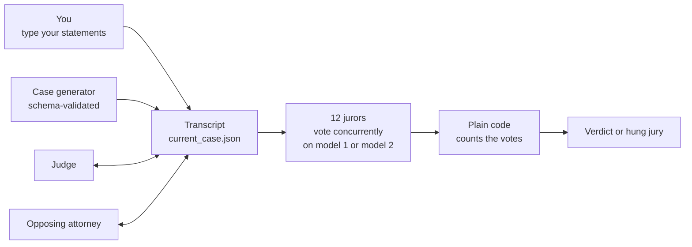
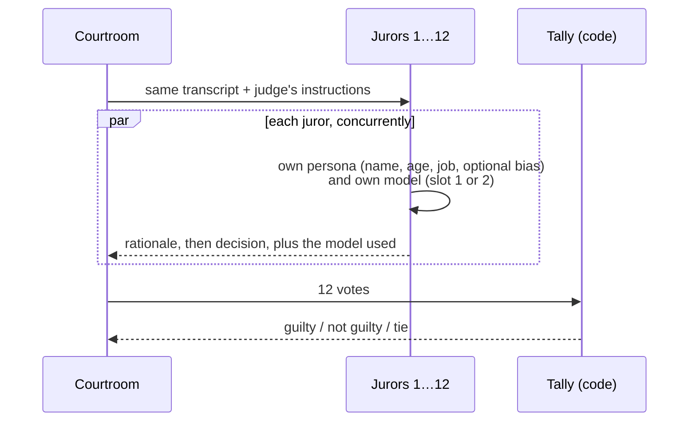

# AI Court Simulator: Technical Deep Dive

A courtroom game where you play the lawyer and everything else is a language model. A judge, an opposing attorney and a jury of twelve are all played by local models. You get a generated criminal case, choose a side, argue it in your own words, and the jury votes. It is a small project, but it needed several real design decisions: how to keep a long, multi-speaker conversation coherent, how to make a model produce data your code can trust, where to let code decide instead of the model, and how to let different models play different roles without the rest of the system noticing.

**My role:** sole builder. I designed the trial flow, the prompts, the data model and the interface. It is a personal project with no commercial deployment, and I have not run a formal evaluation of it.

> The code of this project is on [GitHub](https://github.com/filbezerianos/ai-court-simulator) under the MIT licence. This page explains how it works and why I made the choices I did.

    

# What this is, in engineering terms

Most LLM demos are one human talking to one model. This one has one human and four kinds of AI character who must stay consistent with each other over a long session, and who can each be played by a different model. That raises a few problems:

1. How do you make a model **invent structured data** (a case) that your code can rely on?
2. How do you keep several AI speakers **consistent with a growing shared history** without a database or an agent framework?
3. How do you stop the model **inventing facts** that break the case?
4. How do you get a **fair-looking verdict** from a model that tends to agree with whoever spoke last, and from a jury whose members all think alike?
5. How do you make a session **survive a page refresh or a crash**?
6. How do you **mix models** across roles while keeping every call going through one code path?

# Architecture



| Layer | Choice |
|---|---|
| Inference | Open-weight models served locally by Ollama. Up to four model names can be set: one for the case and the judge, one for the opposing attorney, and two for the jurors |
| Client | The `ollama` Python client, async; no API key, no cloud calls |
| Validation | Pydantic models and JSON schemas for every structured answer |
| UI | NiceGUI single-page app with three tabs: Courtroom, Jury, Settings |
| Persistence | One JSON file for the current trial; separate files for jurors and settings |
| Prompts | Plain markdown files with `$placeholders`, filled by `string.Template` |
| Dependencies | Three packages (`nicegui`, `ollama`, `pydantic`) |

# Which model plays which role

Each setting maps to one job:

| Setting | Used for |
|---|---|
| `model` | Generating the case, and the judge. It is also the default for any call that does not name a model |
| `opponent_model` | The opposing attorney |
| `juror_model_1`, `juror_model_2` | The two models available to jurors |

The only change to the shared model call is one optional `model` argument. If a caller passes a model, it is used. If not, the call falls back to `model` from the settings. Everything else (the schema validation, the retries, the prompt loading) is the same for every role, so adding a model to a role did not add a second code path.

I stopped at two juror models on purpose. Two is enough to answer the question I cared about, which is whether a mixed jury behaves differently, and it keeps the Jury tab to a simple dropdown per juror. A free-form model per juror would be more flexible, but also twelve things to configure and twelve models to pull.

# The trial is a fixed script and the transcript is the state

The order of the trial is a short list: the judge opens, each side gives an opening statement, each side presents evidence, and the judge instructs the jury. Every step adds exactly one entry to the transcript, so:

```text
next step = TRIAL_STAGES[len(transcript)]
```

There is no separate "current stage" variable that can drift out of sync. The position in the trial is derived from the saved transcript, so a page refresh, a closed browser or a crash cannot leave the game in an impossible state. The only thing that decides who speaks next is how many people have already spoken.

The player and the AI take turns by side. If the next speaker is the player, the UI shows a text box. If it is the opponent or the judge, the UI shows a Continue button. This is the only branching in the flow.

# Making a model produce data: the case generator

A case is a typed object with ten fields: title, charge, defendant, summary, context, twist, evidence, witnesses, and a personality for the judge and for the opponent. The model is not asked to "write a case". It is asked to fill a **JSON schema**, and the answer is validated with Pydantic.

- If the answer does not validate, the call is **retried up to three times**, and then fails with a clear error. Invalid output is never half-used.
- Randomness comes from **code, not from the model**: a random topic and a random setting are picked from a list and given to the prompt. Asking a model to be random produces the same few cases; asking it to elaborate on a random seed produces variety.
- The prompt constrains the story. The case has to leave room for both guilt and reasonable doubt, give the prosecution at least two strong pieces of evidence and the defence at least two credible doubts, and keep the summary consistent with the evidence list. The twist must complicate the prosecution's story and not resolve it.
- The prompt is told the names of the player, the opponent and the judge, and told **not to reuse them** for the defendant or witnesses. Without this, a case can contain a witness with the same name as your opposing counsel.

# Keeping the AI speakers honest: closed-world prompts

The opposing attorney and the judge are told what they may use. The attorney's system prompt contains the full case, the numbered evidence (E1, E2…) and the list of witnesses, followed by an explicit rule: **use only this evidence, never invent new evidence or witnesses**. It also says to speak to the jury in the first person, to respond to what the other side actually said, and to avoid headings and stage directions so the output reads as spoken text.

The attorney runs on its own `opponent_model`, separate from the judge. That matters more than it sounds: the opponent writes the longest and most argumentative text in the game, so it is the role where a larger model is most noticeable, while the judge can stay on a lighter one.

This does not make invention impossible, and I have not measured how often a small model breaks the rule. It makes the right behaviour the easiest one, and the numbered evidence gives both the AI and the human a shared vocabulary to refer to.

Each speaker also gets the **whole transcript so far**, formatted as plain text with the speaker, role and stage on each entry. There is no summarising or truncation. For a short trial this is fine, and it is the simplest thing that works. It is also the reason the design would need rethinking for a longer one (see limitations). Because the transcript is plain text, it does not matter which model wrote each entry: any other model can read it.

# The jury: independent votes, counted by code

This is the part I find most interesting.



**Independent calls.** Each juror is a separate model call, run concurrently, with its own system prompt built from a name, an age, an occupation and an optional bias. Jurors never see each other's votes. They all see the same transcript and the same judge's instructions.

**A model per juror.** Each juror has a model slot, 1 or 2, chosen from a dropdown in the Jury tab. The slot points at `juror_model_1` or `juror_model_2` in the settings, and defaults to 1. A single jury can therefore mix, for example, a small fast model and a larger reasoning model. The slot, not the model name, is stored on the juror. That way, changing a model in Settings changes it for every juror using that slot, with no need to edit twelve jurors.

**The vote remembers its model.** Each vote records the name of the model that produced it, next to the juror, the decision and the rationale. The verdict screen shows it under each juror's badge. Without that, a mixed jury would be hard to read: you could see that the jury split, but not whether it split along model lines. Rounds saved before this existed have no model, and the screen simply leaves it blank for them.

**Reasoning before the decision.** The schema for a juror's answer has the `rationale` field first and `decision` second, and the decision can only be `"guilty"` or `"not guilty"`. A model writes in order, so it has to explain itself before it commits. Asking for the verdict first tends to produce a verdict and a justification written to fit it.

**Code decides, the model doesn't.** The model never counts anything. A small function tallies the twelve votes and returns "guilty", "not guilty" or "tie". Another decides whether the player won based on their side. These are plain, testable functions, and they do not care which models cast the votes, so the outcome of the game can't be argued with by a model.

**A tie is a result, not an error.** Twelve is even, so 6-6 is possible. Rather than hide it, the game shows a hung jury and lets the jurors vote again. Votes are sampled with some temperature, so a second round can come out differently.

**Fail together.** If one juror cannot produce a valid answer after three attempts, the other eleven calls are cancelled and the error is shown, naming the juror and the model that failed. A verdict of eleven jurors is not saved. With two models, this is also how a mistyped or unpulled model name shows up: the jurors on that model fail, and the message says which one.

**Visible reasoning.** Each juror's rationale is shown next to their vote, in an expandable panel. The player can see why the jury decided as it did, not just what it decided.

**Editable jurors.** Name, age, occupation, bias and model can be edited, so a juror who "deeply distrusts authority figures" changes the outcome, and so does moving half the jury onto a different model. This makes the jury a controlled input and not a fixed oracle.

# Persistence

- The whole trial (case, cast, transcript and verdict rounds) is one JSON file.
- Every write goes to a **temporary file first and is then moved over the real one**, so a crash in the middle of a save cannot corrupt the game.
- Finished cases can be saved as a timestamped copy.
- Jurors and settings are separate files, with a default jury file for resetting. The settings hold the four model names, and each juror holds its model slot.

# Local-first by design

- The models run on the player's own machine through Ollama. Nothing leaves the machine, and there is no per-token cost.
- Twelve concurrent calls would be expensive on a hosted API, but are free to try here, which is part of why the jury is built the way it is.
- The prompts are plain markdown files, so the behaviour of the judge, the lawyers and the jurors can be changed without touching the code.
- The cost of mixing models is local too. Every model you use has to be pulled, has to support structured (JSON) output, and takes memory. Ollama may have to swap models in and out, so a two-model jury can be noticeably slower at the verdict than a one-model one.

# Engineering trade-offs

| Decision | Why | Cost |
|---|---|---|
| Transcript length defines the stage | No state to get out of sync; resilient to refresh and crash | Stages can only be appended, not edited or skipped |
| Schema-constrained output with retries | Code can trust what comes back | Three failed attempts means a failed step |
| Code picks the case topic | Real variety, which a model asked to "be random" does not give | The range is only as wide as my list of topics |
| Rationale before decision | The vote is justified, not rationalised | Longer answers, slower voting |
| Twelve separate calls | Independent, persona-specific votes | Twelve times the load on a local model |
| Two juror models, picked by slot | A mixed jury with one dropdown per juror, and one place to change a model | Only two models per jury; more memory and slower voting |
| A separate model for the opponent | The role that argues the most can use the strongest model | Another model to pull and keep in memory |
| Code counts the votes | Deterministic, testable outcome | The model cannot weigh a vote more or less strongly |
| Whole transcript in every prompt | Simplest way to keep everyone consistent | Cost grows with trial length |
| One JSON file for the trial | Zero infrastructure, easy to inspect | One game at a time |

# Known limitations and roadmap

I would rather be clear about what this is not.

- **The trial is incomplete.** There are no closing arguments yet, and the judge only opens and instructs. Nobody rules on anything.
- **The jury is not a fair test of your argument.** Mixing two models makes the jury less uniform, but the votes are still correlated: there are twelve personas on at most two models. I have not measured whether verdicts follow the quality of the arguments, the evidence, the persona or the model. A mixed jury is more varied, not necessarily more accurate. It is a game, not a model of real juries.
- **I have not compared the models.** The game records which model cast each vote, so the data to see whether one model leans guilty or not guilty is there, but I have not analysed it.
- **Small local models are inconsistent.** They can contradict the case, repeat themselves, or ignore the "use only this evidence" rule. Larger models do better but are slower.
- **Model names are free text.** Settings do not check that a model is pulled or supports structured output. A wrong name only shows up at the first call that uses it, as a failed step.
- **The juror slot is resolved when the jury votes.** Changing a juror model in Settings during a game applies to the next round, so a hung jury's second round can use different models from the first. The saved model on each vote makes this visible, but does not prevent it.
- **Single player, single session.** The state is one global file. A second browser tab shares the same game, and a stale tab can act on a case that was just cleared.
- **Hung juries can repeat.** There is no cap on the number of rounds.
- **The player's input is lightly checked.** A statement only has to be 50 characters long. It is not checked against the evidence, and it goes straight into the prompts, so it is not safe for anything beyond a local, single-player game.
- **Context grows with the trial.** Passing the full transcript is fine for six speeches, but would hit the model's context limit in a longer one, and the smallest model in the mix sets the limit.

# What I took from it

The project is small, but the pattern is one I use in product work. Models are good at producing things that read well: a story, a speech, an opinion. They are not what you want counting votes, tracking where you are in a process, or guaranteeing a format. So I let the model write, and let validated schemas and plain code decide what is accepted, what happens next and who wins. Adding multiple models was a good test of that: because the model is just an argument to one shared call, and everything downstream is validated and counted by code, swapping or mixing models changed who writes, and nothing about how the game is decided.

[View the code on GitHub →](https://github.com/filbezerianos/ai-court-simulator)
