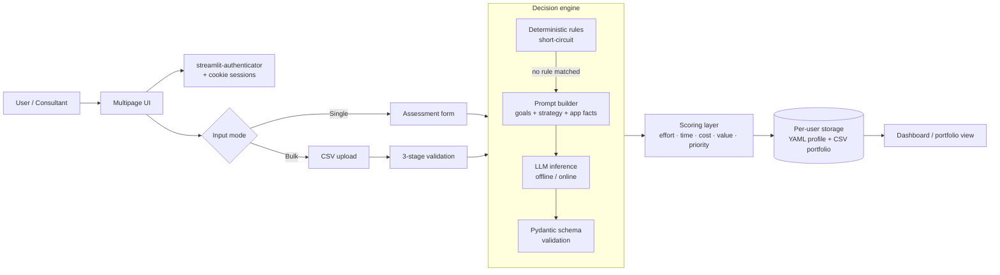

# AI Cloud Migrator: Technical Deep Dive

> A hybrid rules and LLM decision engine that recommends a cloud migration strategy (the "7 Rs") for each application, then scores effort, value and priority. **Source code is private.** This page documents the architecture and design decisions. [Business context, problem and results on filbezerianos.com](https://filbezerianos.com/portfolio/cloud-migration-strategy-ai-tool/)

   


# The problem, in engineering terms

Cloud assessments are slow because each application needs a judgement that blends **hard constraints** (end-of-life OS, unsupported database versions, 32-bit dependencies) with **soft, organisation-specific preferences** (cost reduction vs. modernisation, "move fast" vs. "SaaS first").

Pure rules can't handle the free-text, contextual part. A pure LLM is not reliable or auditable enough for the hard constraints. The design goal was to **use each approach where it is strongest**.

# Architecture



| Layer | Choice |
|---|---|
| UI | Streamlit (multipage app, `st.data_editor` with column configs for the portfolio view) |
| Auth | `streamlit-authenticator` + `streamlit-cookies-controller`, with single-session enforcement |
| LLM, local | LM Studio's OpenAI-compatible endpoint via the `openai` SDK, running `gpt-oss-20b` |
| LLM, hosted | Hugging Face Inference API, `Llama-3.1-8B-Instruct` |
| Validation | Pydantic v2 (`Literal` types, field validators) |
| Data | Pandas; per-user YAML (profile, credits) and CSV (assessed portfolio); storage code written to be swappable to S3 |

# The core idea: a hybrid decision engine

Not every application needs an LLM. The engine runs **ordered deterministic rules first** and only calls the model when no rule decides the outcome.

Why this matters:
- **Predictability.** Cases with a clear answer are decided the same way every time, with no model variance.
- **Cost and latency.** Some applications never reach the model, so they use no inference time.
- **Smaller LLM job.** The model chooses between three strategies instead of seven, which makes a small model (8B–20B parameters) viable.

# Making the LLM behave

## Policy encoded in the prompt

The system prompt is structured as sections, each acting like a policy module:

- **Goal-driven preference ordering.** For example, "reduce cost" prefers Replatform > Rehost > Refactor, while "modernise platform" forbids Rehost.
- **Strategy-driven ordering.** For example, "SaaS over PaaS over IaaS" or "move fast and modernise later".
- **Hard constraints.** Unsupported OS and database versions (e.g. Windows 2003, MySQL < 5.6, PostgreSQL < 9.6) must exclude Rehost.
- **A strict output contract.** JSON only, fixed keys, length-limited reasons, and a worked example.

The user prompt is assembled from the organisation's goals and strategies (including free-text "other" entries) plus the application's facts, so the same application can get different recommendations for organisations with different goals.

## Structured-output validation

```python
class inference_json_response(BaseModel):
    strategy: Literal["Refactor", "Replatform", "Rehost"]
    strategy_reason: str
    complexity: Literal["Very Low", "Low", "Medium", "High", "Very High"]
    complexity_reason: str
    # validators strip and cap reason length
```

- Output is parsed with `json.loads` and then validated by Pydantic. Any enum violation, missing key or malformed JSON returns `None`.
- A `None` becomes an explicit **`Error` state** with zero scores. The application is flagged and, importantly, **no usage credit is consumed**, so a model failure never costs the customer.

## Swappable inference backend
A single config flag (`MODE_OF_OPERATION`) switches between a **local model** (data stays on the machine, useful for sensitive application inventories) and a **hosted model**. Both sit behind one `MODEL_INFERENCE()` function with the same prompt and validation path.

# Scoring: turning a recommendation into a prioritised plan

A strategy on its own doesn't tell a team what to migrate first. After the decision, a deterministic scoring layer produces comparable numbers.

Each strategy has base scores for effort, time, cost and value. Each complexity level has a configurable multiplier based on the specific organisation characteristics. For example:

| Strategy | Effort | Time | Cost | Value |
|---|---|---|---|---|
| Retain | 0.1 | 0.1 | 0.4 | 0.1 |
| Retire | 0.2 | 0.2 | 0.1 | 0.2 |
| Rehost | 0.4 | 0.4 | 0.6 | 0.4 |
| Repurchase | 0.6 | 0.4 | 0.8 | 0.6 |
| Replatform | 0.6 | 0.6 | 0.8 | 0.8 |
| Refactor | 1.0 | 1.0 | 1.0 | 1.0 |

Complexity multipliers: Low 0.7 · Medium 0.85 · High 1.0.

```text
effort_i      = strategy_i × complexity
total_effort  = mean(effort, time, cost)
priority      = (1 − total_effort + value) / 2
```

Scores are banded into **Low / Low to Medium / Medium / Medium to High / High**.

All multipliers live in one config module, so a consultancy can recalibrate the scoring to its own estimation model without touching the logic.

# Bulk assessment pipeline

Consultants assess a whole estate at once from a CSV template.

1. **Pre-flight credit check.** The row count is compared against available credits before any processing.
2. **Three-stage validation, fail-fast:** (a) exact header match, reporting both missing and unexpected columns; (b) per-column max-length rules; (c) enumerated-value checks (e.g. `Users`, `EoL Timeframe`). Offending rows are shown back in the UI.
3. **Sequential processing** with a live progress bar. Each row goes through the same engine as the single-application flow, so results are identical.
4. **Per-row metering.** A credit is consumed only for a valid result.

# Multi-tenancy, sessions and usage metering

- Each user has an isolated profile (organisation goals and strategy, cloud providers, credits) and an isolated application portfolio.
- Credit accounting separates `application_credits` from `credits_used`, which makes a freemium or pilot model easy to run.
- Sessions use signed cookies with `single_session=True`, and every page guards on authentication state.

# Engineering trade-offs

| Decision | Why | Cost |
|---|---|---|
| Rules before LLM | Determinism and fewer model calls | Rules must be maintained as policy changes |
| Small, constrained model | Cheap, can run locally, fast | Needs a strict prompt and output validation |
| Config-driven scoring | Calibratable per consultancy | Scores are heuristic, not costed estimates |
| File-based storage first | Fast to build and run in a pilot | Needs a database to scale (see roadmap) |
| Streamlit | Very fast iteration with consultants | Limited concurrency and control over UI state |

# Results

Reported from pilot deployments with consulting partners: **~60% reduction in assessment-phase duration** and **~50% reduction in resource demand**.
Details and context: [website case study](https://filbezerianos.com/portfolio/cloud-migration-strategy-ai-tool/).

## My role

Product Manager and AI/Technical Lead. I designed the decision logic, prompt and validation strategy, and scoring model, and led the engineer and cloud architect who built and validated it with consulting partners.
