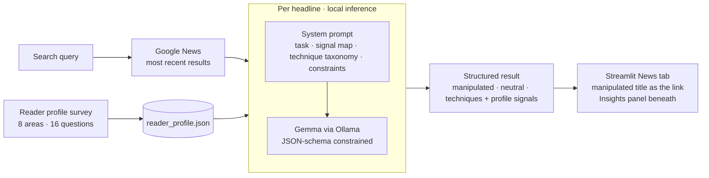

# News Titles Shift: Technical Deep Dive

> A local-first experiment that rewrites live news headlines for a specific reader profile, then shows exactly how it did it. Each headline comes back in three versions (manipulated, original and neutral) plus a breakdown of the persuasion techniques used, each traced to a signal in the reader's profile. **Source code is private.** This page documents the architecture and design decisions. [The idea, the build and the findings on filbezerianos.com](https://filbezerianos.com/portfolio/news-titles-shift/)

   

# What this is, in engineering terms

Headline optimisation is usually invisible: a platform decides how to frame a story for you, and you never see the alternatives. The goal here was to **make that process legible**:

1. Take **live** headlines (not a static dataset);
2. Personalise them against a **structured psychological profile**;
3. Return **explainable** output: what changed, which technique was used, and which profile signal triggered it;
4. Do it **without any sensitive data leaving the machine**.

# Architecture



| Layer | Choice |
|---|---|
| UI | Streamlit, News and Config (reader profile) |
| News source | Google News via the `gnews` client; live query, 5 most recent results |
| Inference | Gemma running locally through Ollama; no cloud LLM calls |
| Output control | Ollama structured outputs (JSON schema passed as `format`) |
| State | Reader profile persisted as JSON; results held in session state |

# The reader profile: structured input, not free text

The profile is the foundation of the system. Eight dimensions, two questions each:

| Dimension | What it captures |
|---|---|
| Emotional baseline | Typical reaction to headlines; how long it lingers |
| Institutional trust | Trust in media; first instinct on reading a headline |
| Click motivation | What triggers a click; ranking of what a headline should do |
| Political & social identity | Political leaning; ranking of central identities |
| Perceived personal threat | Sense of security; ranking of risk domains |
| Media diet | Where headlines are encountered; source variety |
| Cognitive style | What drives opinions; reaction to contradicting headlines |
| Current emotional state | Mood *right now* and relative to usual |

Design decisions:
- **Closed-choice and ranked answers.** Fixed options (plus rank-ordering for priorities) keep the profile compact, answerable in a few minutes, and unambiguous for the model, with no free-text noise.
- **Stable traits plus a volatile state.** Seven dimensions are relatively stable; *current emotional state* is deliberately separate, because the same person is open to different techniques when anxious than when calm.
- **Self-describing JSON.** Each answer is stored with its question text, so the model receives the profile as readable key-value context. No encoding or lookup tables are needed.
- **Persisted across sessions** as a plain file, so there is no account system and no database.

The framework went through several iterations before settling, balancing psychological grounding against what a person can answer honestly in a short survey.

# The rewriting engine

## One structured call per headline
Each headline is sent to the local model with the system prompt and the full profile. The response is constrained by a JSON schema and returns:

```json
{
  "original_title": "…",
  "manipulated_title": "…",
  "neutral_title": "…",
  "manipulation_technique": [
    { "technique": "…", "profile_signal": "…", "explanation": "…" }
  ]
}
```

Producing the manipulated version, the neutral baseline and the explanation **in the same call** means all three are consistent with each other, and the neutral version serves as a built-in control for comparison.

## Prompt architecture
The system prompt is organised into explicit sections:
- **Task:** the three required outputs;
- **Signal map:** which profile field informs which kind of decision;
- **Closed technique taxonomy:** eight named techniques, each with a one-line definition, and an instruction to use only those names;
- **Constraints:** factual accuracy, selectivity, plain-English explanations;
- **Output contract:** structure and strict-JSON rules.

## Selectivity is the hard part
A model that applies every technique to every headline produces output that reads as *unhinged* rather than *targeted*. The prompt therefore requires that a technique be used **only when a specific profile signal triggers it**, and that the signal be named in the output. This keeps rewrites plausible and makes each technique auditable. Getting this to hold across different headline types and profile combinations took the most iteration.

## Traceability by construction
`profile_signal` is a required field on every technique. The model has to say *why* it chose a technique for this reader, which turns a black-box rewrite into something a person can check against their own answers.

# Prompt evolution

The prompt went through a deliberate redesign:

| Version | Stance | Output |
|---|---|---|
| v1 | "Personalise the headline for click likelihood": utility-first rules (be concrete, match tone to mood, don't manufacture anxiety), with explicit restraint | One rewritten title |
| v2 | Name the persuasion techniques explicitly, require a neutral baseline, and require every technique to be explained and traced to a profile signal | Manipulated + neutral + technique breakdown |

The shift from "a better rewrite" to **"a rewrite plus its own explanation"** is what turns the tool from a headline rewriter into something a reader can learn from.

An earlier iteration also used an agent framework with a separate "reader agent" to judge click likelihood. It was removed in favour of a **single schema-constrained call**: fewer moving parts, lower latency and more predictable behaviour on a small local model.

# The transparency layer

- The **manipulated headline is the clickable link**, shown exactly as a platform would present it.
- A collapsible **Insights** panel sits beneath each result with the original headline, the neutral rewrite and the technique breakdown.

All three versions are visible at once, so the reader sees precisely what changed and why.

# Privacy by design

The profile contains genuinely sensitive psychological data (political leaning, perceived threats, emotional state). The design keeps it on the machine:
- inference runs **locally** through Ollama, so the profile never reaches a third-party API;
- the only outbound request is the **news search query**;
- the profile is a local file the user controls.

# Responsible design

This is a dual-use demonstration, so the guardrails are part of the architecture:
- **Factual accuracy is a hard constraint.** Manipulated titles may reframe, not fabricate; no invented claims or statistics.
- **Output is always explained.** There is no mode that produces the manipulated headline without the breakdown.
- **Closed technique vocabulary.** Techniques are named and defined, so the output teaches recognition.
- **Purpose is education.** The tool exists to make the practice visible. The full prompt is intentionally not published.

# Engineering trade-offs

| Decision | Why | Cost |
|---|---|---|
| Local small model | Privacy, no API cost, offline-capable | Weaker instruction-following than frontier models; needs strict schemas |
| Single call returning all three versions | Consistency, a built-in control, one round-trip | Longer single generation per headline |
| Closed-choice survey | Compact, unambiguous model input | Coarse profile; can't capture nuance |
| Live news, 5 results | Real, current headlines | Sequential local inference makes a search feel slow |
| Profile as readable JSON | Easy to inspect and debug | No numeric weighting of signals |

# What the experiment showed

From testing across multiple reader profiles and topics: `[CONFIRM: method, number of profiles, number of headlines, and who/what judged "click impulse"]`

- Manipulated headlines generated a stronger click impulse than the original or the neutral rewrite, most strongly for profiles with **high emotional reactivity and low institutional trust**.
- The same headline was rewritten in **entirely different directions** for different profiles.
- **Outrage priming** and **in-group threat** were the most frequently triggered techniques across profiles regardless of political leaning. What differed was who was threatened and what the outrage targeted; the mechanism was the same.

Full narrative: [website case study](https://filbezerianos.com/portfolio/news-titles-shift/).

# My role

Sole builder: profile framework design, prompt engineering, application architecture and interface.
