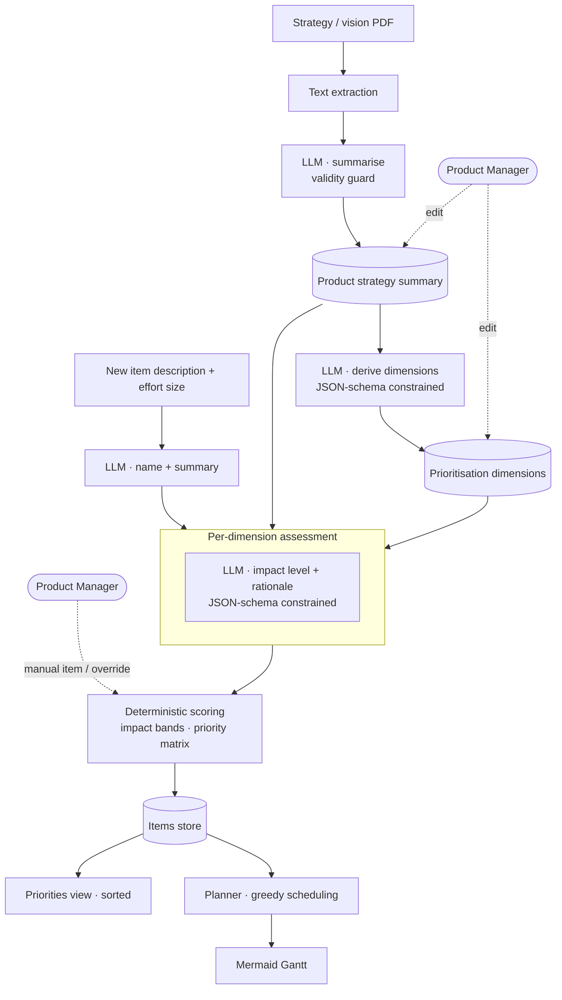

# Product Work Focus Tool: Technical Deep Dive

> An AI-assisted prioritisation tool that derives **strategy-specific prioritisation dimensions** from a product strategy document, assesses each work item against them with a written rationale, and converts the result into a **deterministic priority (P1–P4)** and an indicative delivery plan, with the Product Manager in control at every step. **Source code is private.** This page documents the architecture and design decisions. [Business context, problem and results on filbezerianos.com](https://filbezerianos.com/portfolio/product-work-focus-tool/)

  -green) 

# The problem, in engineering terms

Generic frameworks (RICE, MoSCoW) are product-agnostic by design, so teams re-interpret them for every product and every session, which is slow and inconsistent. The goal was to make the framework itself **derive from the product's own strategy**, and then apply it **identically to every item**.

That splits the problem in two, and the architecture follows the split:

| Needs judgement (LLM) | Needs consistency (code) |
|---|---|
| Summarise a strategy document | Convert impact levels to a score |
| Propose strategy-specific dimensions | Combine impact and effort into a priority |
| Assess one item against one dimension, with a rationale | Sort, plan and schedule |

# Architecture



| Layer | Choice |
|---|---|
| UI | Streamlit multi-tab app (Priorities · Strategy · Details · Plan); dialogs for add/edit flows |
| LLM | Llama 3.1 8B Instruct served locally via LM Studio, called through the OpenAI-compatible API |
| Structured output | JSON-schema `response_format` on every call that feeds code |
| Document input | PDF text extraction (PyPDF2) |
| Planning visual | Mermaid Gantt rendered in-app |
| Storage | Flat files (strategy text, dimensions CSV, items CSV): single-user by design |

**Local-first inference.** Product strategy documents are among the most sensitive things a company has. Using a local model behind an OpenAI-compatible interface keeps documents on the machine, and the endpoint is a single config value, so a hosted model is a one-line change.

# Deriving the framework from the strategy

## Summarise first, reason second
The uploaded PDF is turned into a **bounded, plain-text summary** (4,000-character cap, fixed structure, no editorialising). Every later call uses this summary rather than the raw document, which gives:
- a **small, stable context** for each downstream call (important for an 8B model);
- a **human-readable, editable** artefact: the PM can correct the summary and everything downstream follows;
- a **validity guard**: if the input isn't clearly a strategy or vision document, the model must return a fixed sentinel, and the app rejects it instead of building a framework from the wrong text.

## Generate exactly five dimensions
The model proposes five dimensions (name plus a short description) under explicit constraints: aligned to the strategy, **distinct and non-overlapping**, assessable at feature level, and **not invented beyond the input**. Output is JSON-schema constrained, so the app never parses free text.

The PM can **edit, rename or replace** any dimension and save. Generated dimensions are a starting point, not an answer.

# Assessing an item: isolated, explainable judgements

For each new item the system makes:
1. **One normalisation call**: a short name and a ≤1000-character summary from the free-text description.
2. **Five independent assessment calls**, one per dimension. Each call receives *only* that dimension (name and description), the strategy summary, and the item. The output is schema-constrained:

```json
{ "impact": "No Impact | Indirect Impact | Direct Impact",
  "rationale": "…" }
```

Why one call per dimension rather than one big call:
- **No cross-contamination.** A strong signal on one dimension can't bias the others, which matters for small models.
- **Per-dimension rationale.** Each score has its own written reason, shown next to it, so a PM can challenge a single judgement.
- **A three-level ordinal scale**: easier for a model to apply consistently than a 1–10 score, and easier for a human to review.

Trade-off: six sequential calls per item cost latency. The five assessments are independent and are an obvious candidate for parallel execution (see roadmap).

# From judgements to a priority: all deterministic

The LLM never produces a score or a priority. After the assessments, plain code does the rest.

**Impact.** Each dimension maps to 0 (No) / 1 (Indirect) / 2 (Direct). The five are summed (0–10) and banded:

| Sum | Impact |
|---|---|
| 0 | No Impact |
| 1–2 | Low |
| 3–4 | Low/Medium |
| 5–6 | Medium |
| 7–8 | Medium/High |
| 9–10 | High |

**Priority.** Impact band × effort size (X-Small → X-Large, human-entered) looks up a priority matrix:

| Impact \ Effort | X-Small | Small | Medium | Large | X-Large |
|---|---|---|---|---|---|
| High | P1 | P1 | P2 | P2 | P3 |
| Medium/High | P1 | P1 | P2 | P3 | P3 |
| Medium | P2 | P2 | P2 | P3 | P4 |
| Low/Medium | P2 | P3 | P3 | P4 | P4 |
| Low | P3 | P3 | P4 | P4 | P4 |
| No Impact | P4 | P4 | P4 | P4 | P4 |

Items are sorted by priority, then **impact (descending)**, then **effort (ascending)**, so among equal priorities the higher-value, cheaper item comes first.

**Worked example.** An item rated Direct, Direct, Indirect, No Impact, Indirect scores 2+2+1+0+1 = **6 → Medium**. With effort **Small**, the matrix gives **P2**.

Because the scoring is a lookup table, the same ratings always produce the same priority, and the PM can see *exactly* why an item is P2. The model's rationale explains the *inputs*; the code explains the *output*.

# Keeping the Product Manager in control

| Control point | How |
|---|---|
| Strategy summary | Editable text, saved as the source of truth for all later calls |
| Dimensions | Editable table; auto-regeneration is optional and explicit |
| Item assessment | Every dimension value, with its rationale, is visible and can be adjusted |
| Manual items | A separate entry path with the same scoring logic; items are flagged as manual vs. AI-assessed |
| Effort | Always entered by a human, never inferred |

The design principle: **the AI proposes, the PM disposes**, and every override flows through the same scoring code as AI output.

# From priorities to an indicative plan

The planner turns the ranked list into a timeline:
- **Effort sizes map to weeks** (editable, validated to be strictly increasing so sizes stay meaningful).
- **Parallel capacity** is a single parameter, "items in parallel".
- Items are scheduled in priority order with a **greedy list-scheduling approach**: the next item starts when the earliest lane frees up.
- The output is a generated **Mermaid Gantt** chart.

It is deliberately an *indicative* plan: no dependencies, skills or per-person capacity, just enough to show what the next quarter looks like when the priorities are followed.

# Engineering trade-offs

| Decision | Why | Cost |
|---|---|---|
| LLM as classifier, code as scorer | Consistent, auditable priorities | Fixed three-level scale loses nuance |
| Five isolated calls per item | Clean rationale, no bias bleed | More latency per item |
| Summary-first context | Small prompts, editable, cheap | Information loss if the summary is poor (hence editable) |
| Local 8B model | Data stays local, zero API cost | Lower raw capability than frontier models |
| Equal-weight dimensions | Simple, transparent | PM can't yet say "growth matters twice as much" |
| Flat-file storage | Fast to build and demo | Single user; no history or collaboration |

# Results and what came next

- Early testing with a select group of Product Managers: **up to 50% less time** to prioritise a feature and produce an initial delivery plan, and a process that felt **more defensible** because every assessment came with a rationale to discuss.
- The ideas proven here (deriving dimensions from strategy, assessing work consistently, keeping the PM in control) became the foundation for the AI product platform I built at Kantar with Copilot Studio.

Details: [website case study](https://filbezerianos.com/portfolio/product-work-focus-tool/).

# My role

Technical Lead and Product Manager. I designed the prioritisation framework, the prompt and schema strategy, and the scoring model, and built the application.
