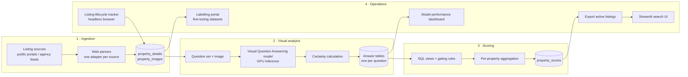

# Property Visual Finder: Technical Deep Dive

> A computer-vision pipeline that reads property listing photos, answers structured questions about each image, and aggregates the answers into per-property visual feature scores (such as natural light, large windows, high ceilings, carpets, fireplaces, photo quality) that can be filtered and sorted. **Source code is private.** This page documents the architecture and design decisions. [Business context, problem and results on filbezerianos.com](https://filbezerianos.com/portfolio/ai-powered-property-photo-analyser/) · [Solution overview (PDF)](https://filbezerianos.com/documents/ai-powered-property-photo-analyser/Property-Visual-Finder-Overview-English.pdf)

    

# The problem, in engineering terms

Listings are searchable by structured fields (e.g price, beds, location), but the most influential content, the photos, is unstructured. To make it searchable, the system has to:

1. Turn **hundreds of thousands of uncontrolled images** (varying quality, angles, rooms) into **structured, comparable signals**;
2. Do it **cheaply and repeatably**, with new listings arriving and old ones expiring constantly;
3. Be honest about **uncertainty**, because a vision model is wrong some of the time and a bad photo is not a bad property.

# Architecture



| Layer | Choice |
|---|---|
| Vision model | Hugging Face `visual-question-answering` pipeline (ViLT-based VQA model) on GPU. `[CONFIRM: fine-tuned model / version in production]` |
| Storage | SQLite: normalised listing tables, one answer table per question, SQL views for scoring |
| Ingestion | Python + BeautifulSoup/regex adapters per listing source |
| Lifecycle tracking | Playwright (headless Firefox) |
| Apps | Streamlit: search UI, model performance dashboard, labelling portal |
| Data scale | **330k+ images analysed** to date |

Images are stored **by URL, not copied**. They are fetched at inference time, so no image library is built or redistributed.

# Turning photos into signals: question-driven VQA

Instead of one generic "describe this image" prompt, the system asks a **fixed, curated set of closed questions** per image. Each question maps to a feature and to the answer that counts as "good" for that feature. For example:

| Question | Feature |
|---|---|
| Is this inside or outside a house? | Gate: interior photos only |
| Is this a close-up of an object? | Gate: drop detail shots |
| Which room of the house is this? | Router: room-specific features |
| Was this taken with wide lenses? | Photo quality / space perception |
| Does the room have a carpet? | Flooring (scored as *no carpet*) |
| Is there natural light? / Does it have windows? / Large windows? | Natural light, windows |
| Is the photo overprocessed? | Photo-quality penalty |
| Does the room have a high ceiling? / a fireplace? | Character features |

Design choices:
- **Closed questions** keep outputs structured and machine-comparable without free-text parsing.
- **Questions are configuration** (a single dictionary mapping question → answer table → target answer → score column). Adding a new feature, or a new market's feature, means adding an entry, not new code paths.
- **Idempotent and resumable.** Images already answered are skipped, so the pipeline runs incrementally as new listings arrive.

## Parallel execution with an integrity gate
Inference is the bottleneck, so each question can be run as its own process (`--questionkey question_N`), writing to its own CSV. A merge step then imports results **only for images answered for every question** (an inner join across all 11 outputs), and aborts if row counts disagree. This guarantees downstream scoring never sees an image with a partial feature profile.

# Uncertainty-aware answers

The raw VQA output is a ranked answer list with scores. A top answer of "yes" at 0.51 and one at 0.97 shouldn't count the same. Each answer gets a **certainty** that blends the absolute confidence with the margin over the runner-up:

```text
s1, s2   = top-2 answer scores
w        = sqrt(s1)
certainty = w·s1 + (1 − w) · ((s1 − s2) / s1) · (1 − s2)
```

The result is then oriented toward the feature: if the model's top answer matches the "good" answer, the feature score is the certainty; otherwise it is `1 − certainty`.

| Top-2 scores | Certainty |
|---|---|
| 0.90 / 0.05 | **0.90**, confident and clear margin |
| 0.50 / 0.30 | **0.44**, ambiguous, discounted |

Every answer stores the raw scores, the second-best answer and the derived certainty, so thresholds can be re-tuned later without re-running inference.

# From image scores to property scores

A property is judged on its **qualifying photos**, not all photos. The scoring layer applies **gating rules** before averaging:

- **Interior only:** `inside_score` above a threshold (0.5–0.6 depending on feature).
- **No detail shots:** `no_close_up_score` above 0.4–0.5.
- **Room-aware features:** fireplace is only evaluated on living/dining-room photos with room certainty > 0.6; bedroom photos need high room certainty.
- **Stricter thresholds for subjective features** (large windows, ceiling height) than for objective ones.

Per property, the system computes:

| Output | Logic |
|---|---|
| Feature scores | Mean feature score over qualifying photos |
| Evidence counts | Number of photos behind each score, for confidence-aware ranking |
| **Photo sufficiency** | More than 4 usable interior photos |
| **Bedroom coverage** | Confident bedroom photos ≥ number of bedrooms |
| No-data sentinel | `-1` when no qualifying photo exists, so "unknown" is never confused with "bad" |

Storing the **evidence count next to each score** is deliberate. A score based on 1 photo and one based on 12 should not rank the same.

# Keeping the index fresh

Listings disappear, and stale results destroy trust. A lifecycle tracker:
- revisits active listings on a **6-day re-check cycle**;
- detects removal via **HTTP redirect behaviour** (a removed listing redirects away from its URL);
- flags the listing inactive, and only **active** listings are exported to the search app;
- runs a **count-reconciliation check** (details table vs. export view) before exporting, and refuses to publish a mismatched export.

# Model operations

## Performance dashboard
A Streamlit dashboard buckets every answer for a chosen question into five confidence bands (very low → very high) and shows the **distribution of answers inside each band**. This was the main tool for:
- finding questions where the model is systematically unsure (e.g. subjective ones such as "overprocessed");
- choosing the gating thresholds above from data instead of guesswork;
- spotting label drift when the question wording or model changes.

## Labelling portal
An internal Streamlit tool shows sampled images in an editable grid with per-question dropdowns (inside/outside, room type, natural light, fireplace, bathtub vs. shower and so on), producing a **human-labelled dataset** for fine-tuning and evaluation. A dataset creator samples random images from the corpus.

# Engineering trade-offs

| Decision | Why | Cost |
|---|---|---|
| Closed-question VQA instead of captioning | Structured, comparable, cheap to aggregate | Fixed vocabulary; each new feature needs a question and calibration |
| One answer table per question | Independent reruns, parallelism, per-question tuning | More tables; scoring depends on SQL views |
| SQLite | Zero-ops, fast iteration on a single-node GPU box | Not built for concurrent writes or multi-tenant scale |
| Batch pipeline, not live inference | Search stays fast; GPU cost is amortised | Scores lag behind new listings |
| Scores + evidence counts | Honest ranking under uncertainty | More complex to explain in the UI |

# Results

- **330k+ images analysed** across UK listings.
- Integrated into the internal system of a UK real estate agency. Agents report a **17% reduction in time spent on properties that don't meet clients' criteria**.
- Unplanned outcome: agents used the visual assessments as a shared vocabulary for briefing clients.

Details: [website case study](https://filbezerianos.com/portfolio/ai-powered-property-photo-analyser/).

# My role

Product Manager and AI/Technical Lead. I designed the feature taxonomy, the question set, the certainty and scoring logic, and the evaluation tooling, and led two engineers on implementation.
