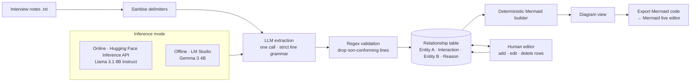

# Relationships Mapping Visualiser: Technical Deep Dive

> Turns unstructured interview notes into an editable diagram of how teams, people and tools interact. An LLM extracts structured relationships from free text, strict validation turns them into a table, and the diagram is generated **deterministically** from that table, so a consultant can correct any mistake in seconds. **Source code is private.** This page documents the architecture and design decisions. [The problem, the solution and results on filbezerianos.com](https://filbezerianos.com/portfolio/relationships-mapping-and-visualisation-tool/)

   

# The problem, in engineering terms

Field notes are free text, written in different styles by different people. The goal is a diagram of *who interacts with whom, how, and why*. That splits into three problems with very different reliability profiles:

| Step | Nature | Best done by |
|---|---|---|
| Find the entities and interactions in messy prose | Fuzzy, language-heavy | LLM |
| Make the result structurally reliable | Strict | Code (validation) |
| Draw it, and let a human fix mistakes | Deterministic, interactive | Code + UI |

The whole design follows from keeping the LLM in the first row only.

# Architecture



| Layer | Choice |
|---|---|
| UI | Streamlit multipage app: Upload → Diagram → Edit |
| Extraction | One LLM call, switchable between a hosted and a local model |
| Data model | A four-column table held in session state |
| Diagram | Mermaid flowchart generated from the table, rendered in-app |
| Persistence | None: the session is the only state (see section 8) |

# Extraction: a strict grammar instead of free-form output

The model is asked to return **only** lines in a fixed grammar:

```text
<Developer> [work together] <Designers> {create the feature's architecture, design and user experience}
```

Why a line grammar:
- it is compact, so small local models follow it reliably;
- each line can be validated with a single regular expression;
- it maps one-to-one to a table row: *Entity A, Interaction, Entity B, Reason*.

## Prompt design
The system prompt encodes the rules that matter for diagram quality:

- **Grounding:** entities must be copied *exactly* as written in the notes; the model may not shorten, rename or invent them.
- **Pairwise decomposition:** an interaction involving three entities becomes separate lines per pair, so the data is a clean graph.
- **Order and de-duplication:** interactions follow the order of the notes; an interaction mentioned repeatedly is listed once.
- **Ambiguity handling:** generic references ("the team") are skipped rather than guessed.
- **Self-check and refusal path:** the model is told to validate its own list before answering, and to return nothing if the notes are too unclear.
- **No commentary:** the output is the list and nothing else.

## Input hygiene
Before the call, the uploaded text is sanitised: the characters `< > { } [ ]` are replaced, so text in the notes can never be confused with the output grammar's delimiters.

## Output validation
The response is split into lines, and **only lines that match the full grammar are kept**:

```text
^<[^>]+> \[[^\]]+\] <[^>]+> \{[^}]+\}$
```

Preambles, stray commentary or half-formed lines are dropped instead of crashing the app. If nothing survives, the user gets a clear error. Valid lines are split into columns, so everything downstream receives clean tabular data.

# Deterministic diagram generation

The LLM never writes the diagram. Code builds the Mermaid flowchart from the table:

```text
flowchart LR
DEVELOPER("Developer") -- "work together" --> DESIGNERS("Designers")
DEVELOPER("Developer") -. "create the feature's architecture…" .-> DESIGNERS("Designers")
```

- **Solid edges** carry the interaction; **dotted edges** carry the reason. A sidebar toggle hides the dotted edges to simplify a busy diagram.
- **Node identity is normalised** (spaces and parentheses stripped, upper-cased), so trivial variants of a name resolve to one node while the original spelling is kept as the label.
- The header shows live counts of unique entities and interactions, and the canvas height scales with the number of relationships.
- The Mermaid source can be **downloaded** and opened in the Mermaid live editor for custom styling.

# Human in the loop

The brief for the editor was: *if fixing an error takes longer than drawing the diagram by hand, the tool has failed.*

- The extracted relationships open in an **editable table**: rename a team, fix an interaction, add a missing row, delete a wrong one.
- Edits are held as **unsaved changes** (with an explicit warning) until saved, so a user can explore changes and discard them safely.
- Saving updates the single source of truth; the diagram is **re-derived** from it, so the table and the picture can never disagree.
- Because the diagram is generated from data, a correction needs no layout work, and a typo fixed once is fixed everywhere it appears in that row.

# How the design evolved

The repository history shows the main architectural decision:

| Stage | Approach | Problem |
|---|---|---|
| Early | Multi-step pipeline: find entities → find relationships between them → a second model reviews the first output and scores completeness → a model writes the Mermaid code. Entities were typed (teams and people as circles, tools as rectangles) | Several model calls to chain; model-written diagram code can be invalid; errors compound across steps |
| Current | **One** extraction call with a strict grammar, a regex gate, and **code** that builds the diagram | Entity types were dropped to keep the grammar simple |

The principle that came out of it: **use the model for understanding language, and code for anything that must be correct**. The review step (an LLM judging an LLM) was replaced by deterministic validation plus a human editor.

# Two inference modes

| Mode | Model | Notes |
|---|---|---|
| Online | Llama 3.1 8B Instruct via the Hugging Face Inference API | Notes are sent to a third-party API |
| Offline | Gemma 3 4B via LM Studio's OpenAI-compatible endpoint | Notes stay on the machine |

The offline mode was added after the first engagements, because interview notes contain sensitive information about how a client organisation really works. Switching is a single configuration value, and both paths share the same prompt, sanitiser and validator.

# Privacy by statelessness

The app does not write interview content to disk. Notes, the extracted table and the diagram live in the user's session and disappear on "Start over" or when the session ends. Combined with offline inference, nothing about a client's organisation has to persist or leave the machine.

# Engineering trade-offs

| Decision | Why | Cost |
|---|---|---|
| One extraction call | Simple, fast, easy to validate | Whole document in one prompt; limited by the model's context window |
| Regex gate, drop invalid lines | Never crashes on messy model output | Silently loses lines that are almost right |
| Code-built diagram | Always valid and consistent with the data | Less flexible layout than a model could "draw" |
| Dual edge types (interaction + reason) | Shows *why* as well as *what* | Doubles the edge count; busy for large maps |
| Stateless sessions | Strong privacy | Nothing to resume; the user must export |
| Small local model option | Confidentiality, no API cost | Lower recall than a frontier model |

# Results

Deployed in small and medium-sized organisations: `[CONFIRM: how measured, number of engagements]`
- **80% reduction** in time spent creating the interactions diagram;
- **15% reduction** in overall process assessment time.

Consultants use it in live engagements, which gives a continuous feedback loop. A questionnaire guide helps teams capture notes in the format the extractor handles best. Details: [website case study](https://filbezerianos.com/portfolio/relationships-mapping-and-visualisation-tool/).

# My role

Sole builder: AI integration and prompt engineering, validation logic, diagram rendering and the editing interface, working closely with the consultants who use it.
