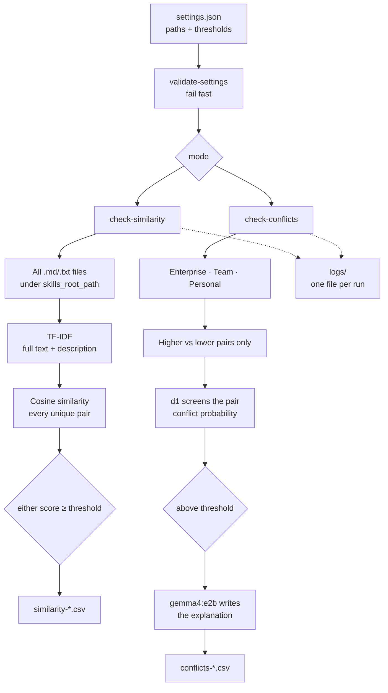

# SkillsCop: Technical Deep Dive

A command line tool that keeps a collection of AI agent skills tidy. Skills are plain Markdown files, and they pile up fast: teams copy each other's, people write personal variants, and sooner or later a personal skill quietly disagrees with a team or enterprise policy. SkillsCop finds skills that say nearly the same thing, and lower level skills that contradict the rules set above them. It is a small tool, but it needed real design decisions: what to let a cheap statistical method decide, what to let a model decide, how to respect a hierarchy of authority, and how to keep a slow model-driven check understandable and auditable.

**My role:** sole builder. I designed the hierarchy model, the two-stage conflict check, the prompts, the settings and the reports. It is a personal project with no commercial deployment, and I have not run a formal evaluation of it.

> The code of this project is on [GitHub](https://github.com/filbezerianos/skillscop) under the Apache 2.0 licence. This page explains how it works and why I made the choices I did.

    

# What this is, in engineering terms

Skills are instructions for AI agents. Once an organisation has them at several levels, you have a small governance problem, and it looks like a document problem more than a code problem. Two questions come up:

1. Which skills are **near duplicates**, so I can merge or retire them?
2. Which lower level skills **contradict a higher level one**, when the higher level is supposed to win?

They need different tools. The first is a question about wording, and can be answered cheaply and deterministically. The second is a question about meaning ("could a reader follow both at once?"), which needs a model, and a model is slower, less predictable and easy to over-trust. That raises a few design problems:

1. How do you **respect a hierarchy** (enterprise > team > personal) and not compare everything with everything?
2. How do you use a **model for judgement** without making it the only thing between you and a wrong answer?
3. How do you keep a **slow, many-pair check** usable, and explain afterwards what it did?
4. How do you keep **sensitive internal policy** on the machine?
5. How do you make the output something a person can **act on**, not just read?

# Architecture



| Layer | Choice |
|---|---|
| Interface | A single Python script with a command line (`click`) and a progress display (`rich`) |
| Similarity | TF-IDF vectors with cosine similarity, from scikit-learn |
| Conflict checking | Two local models served by Ollama: `d1` to screen each pair, `gemma4:e2b` to explain flagged pairs |
| Skill parsing | `python-frontmatter`, to read the `description` from the YAML front matter |
| Configuration | One `settings.json` (ignored by Git), copied from `settings.default.json` |
| Prompts | Two plain Markdown templates, filled with the two skills being compared |
| Output | Timestamped CSV reports and one log file per run |
| Dependencies | Five packages: `click`, `python-frontmatter`, `ollama`, `rich`, `scikit-learn` |

There is no database, no server and no index. The tool reads files, compares them, and writes a CSV.

# The hierarchy is the shape of the problem

Skills belong to one of three levels, and the higher level always wins:

```text
enterprise  >  team  >  personal
```

A conflict only matters in one direction. If a personal skill disagrees with an enterprise policy, the personal skill is the one that is wrong. So `check-conflicts` only compares **across levels, higher against lower**: enterprise against team and personal, and team against personal. It never compares two skills at the same level, and the prompt always names which one has priority.

This does two things. It keeps the model's question well defined, because "does the lower one contradict the higher one?" has a clear answer in a way that "do these two disagree?" does not. And it cuts the number of comparisons, which matters because each one is a model call:

```text
comparisons = E·T + E·P + T·P        (E, T, P = number of enterprise, team, personal skills)
```

Similarity works the other way. Duplicates are a problem wherever they sit, including inside one level, so `check-similarity` compares every unique pair of files under a single root folder.

# Finding near duplicates: cheap and deterministic first

`check-similarity` does not use a model at all.

- **TF-IDF with cosine similarity.** Every `.md` and `.txt` file under the root folder is turned into a TF-IDF vector (English stop words removed, single words and two-word phrases), and cosine similarity is computed for every unique pair.
- **Two scores per pair.** One is the similarity of the full text, the other is the similarity of the `description` in the front matter. Two skills can look different in the body but be described as doing the same job, or the other way around, and the two scores show which.
- **Either score can flag a pair.** A pair is reported if the full text score or the description score meets its own threshold, both set to 0.75 by default.
- **Same input, same answer.** There is no randomness, nothing to pull and no model to wait for. It is fast, and a rerun gives the same report.

I started here on purpose. A lot of duplication is plain copy and paste, and a method that costs nothing should catch it before anything expensive is involved.

# Finding conflicts: a screen, then an explanation

Conflicts are a question about meaning, so this is where a model earns its place. I split the work into two calls with different jobs:

1. **Screen.** For each cross-level pair, a model called `d1` is asked one closed question: *do they contain conflicting instructions? Yes or No?* It returns a probability for the answer, not a paragraph. That number is compared with `instructions_conflict_threshold` (0.7 by default).
2. **Explain.** Only pairs above the threshold go to a second model, `gemma4:e2b`, which is asked to list the specific conflicts in plain text, each in at most three sentences: the topic, what the higher level instructs, what the lower level instructs, and why both cannot be followed.

The reasoning is the one I use elsewhere: a number can be thresholded, sorted and compared across runs, and a paragraph cannot. And a long explanation is only worth paying for on the small number of pairs that look like a problem. The expensive, generative step is spent on the pairs that earn it.

## Defining "conflict" in the prompt

Models over-flag conflicts if you let them. Two skills that are merely about the same topic look suspicious. So both prompts give the model the same definition and the same exclusions.

**A conflict** is when a reader could not follow both instructions at once, for example one requires what the other forbids, they prescribe incompatible values, tools or steps for the same situation, or they give opposite rules for the same trigger.

**Not a conflict** is different topics, one skill adding rules the other doesn't mention, overlap that is compatible, and differences in wording or structure. The prompt also covers the case that confuses people most: a stricter rule that also satisfies the looser one (a 50 character limit and a 72 character limit) is not a conflict.

The detail prompt adds an explicit way out: list only real conflicts, do not add weak ones to make the list longer, and if there are none, reply *No clear conflict found*. That last instruction matters, because a model asked to list conflicts tends to produce some.

I describe the structure of the prompts here and not the full text; they are Markdown files in the repository, so they can be changed without touching the code.

## A note on how the screen is called

The screen is called through Ollama with a closed question and a criterion for each answer, `true` and `false`, and the response carries a probability for the question. The code reads that number and does nothing else with it. The explanation model is a normal chat call.

[TO CONFIRM WITH FIL: what `d1` is and why it was chosen for the screen, and whether to say anything about its availability. See the questions in the thread.]

# Running a slow check responsibly

A model call per pair is slow, so the tool is built to make the wait understandable.

- **Validate first.** Before anything runs, `validate-settings` checks that every path exists and that each threshold is a number between 0 and 1 with at most two decimal places. A wrong path fails in a second, not an hour in. The reports folder is created if it is missing.
- **Say how much work there is.** The tool counts the comparisons before it starts and shows a progress bar with the number done and the time remaining.
- **Log every model call.** Each run writes its own timestamped log file. A line is written for every model call with the model, the pair compared, the probability and the time taken. When a run is slow, the log says which step was slow, and when a result looks odd, it says what was asked.
- **Write a report you can open.** Results go to a timestamped CSV, written with a byte order mark so that Excel opens it correctly.

| Report | Columns |
|---|---|
| `similarity-*.csv` | content similarity score, description similarity score, the two files |
| `conflicts-*.csv` | conflict probability, higher level and path, lower level and path, explanation |

A CSV is deliberately unglamorous. The person reading it will want to sort it, filter it, and send it to a skill owner, and a spreadsheet already does all of that. The rows hold the evidence (the score and the explanation) next to the two paths, so a reviewer can go straight to the files.

# Local-first by design

Skill files are internal policy: exactly the kind of text an organisation does not want to send to a third party.

- The files are read from disk and both models run locally through Ollama. Nothing leaves the machine and there is no per-token cost.
- That also changes the economics. A check that makes a model call for every pair would be expensive on a hosted API, and here it only costs time.
- Settings with local paths are kept out of Git, and the logs warn that they contain file paths.
- The cost is the usual one for local models: they need to be pulled, they take memory, and they are slower and less accurate than the largest hosted ones.

# Engineering trade-offs

| Decision | Why | Cost |
|---|---|---|
| Compare across levels only, higher against lower | A well-posed question for the model, and far fewer calls | Two conflicting skills at the same level are never flagged |
| TF-IDF for duplicates, no model | Fast, free and repeatable | It compares words, not meaning, so a rewritten duplicate can score low |
| Two scores, text and description | Catches duplicates that differ in one place but not the other | Two thresholds to tune, and a missing description scores as no match |
| Screen with a probability, explain only above threshold | The expensive generative step is spent where it matters | A pair the screen misses never gets an explanation |
| One threshold per signal, in settings | The sensitivity is a decision the user owns | There is no universal right value, and I have not tuned the defaults against data |
| A precise definition of "conflict" in the prompt | Fewer false alarms from topical overlap | A definition can also make the model too strict |
| Fail fast on a model error | No half-trusted result | One failed call stops the whole run, and nothing is written |
| CSV and a log file | Open in anything, easy to audit | No interface for working through the results |
| Fail on invalid settings | Misconfiguration is caught before the long step | More strictness than a casual user may want |

# Known limitations and roadmap

I would rather be clear about what this is not.

- **Similarity is lexical.** TF-IDF compares the words used. Two skills that say the same thing in very different words can score low, and two skills that share a lot of boilerplate can score high.
- **Conflict detection is a screening aid, not a verdict.** A local model can be wrong in both directions: it can miss a real conflict, and it can flag a compatible pair. The report is a list of pairs worth a human look.
- **I have not measured accuracy.** I have not built a labelled set of conflicting and compatible skills, so I cannot say how often the screen is right, and the default thresholds are starting points, not tuned values.
- **Run time grows quickly.** A model call for every cross-level pair means a collection of hundreds of skills takes a long time. The progress bar helps, but there is no cache, so a rerun repeats every call, including pairs that have not changed.
- **Whole files go into the prompt.** Each pair is passed in full with no truncation or chunking, so a very long skill could exceed the model's context.
- **Only the pair is compared.** A conflict that appears only when three skills are read together is not found.
- **Same-level conflicts are out of scope.** That is deliberate, given the hierarchy, but it means two contradicting team skills are not flagged.
- **One failed call ends the run.** If the model server is unavailable or a call errors, the tool stops, and the pairs already checked are not written to a report.
- **Reports are not sorted.** Results are written in the order they were found. Sorting by score is a small addition.
- **Output is a CSV.** There is no interface for reviewing, dismissing or tracking findings.

What could come next, roughly in the order I would do it:

1. A small labelled set of skill pairs, so thresholds can be tuned and accuracy reported, not assumed.
2. Caching by file content, so a rerun only checks what changed.
3. A report that is sorted, and optionally partial when a run is interrupted.
4. Semantic similarity with embeddings alongside TF-IDF, to catch rewritten duplicates.

[TO CONFIRM WITH FIL: which of these are real plans, and whether anything else is planned.]

# What I took from it

The pattern is one I use in product work. Use the cheapest method that is good enough first, and keep the model for the question that really needs judgement. Ask it a closed question, get a number back, and let a threshold you can see and change decide what goes forward. The language model writes the explanation, and only for the cases that matter. And since the person reading the result is the one who has to act on it, the output is a spreadsheet of evidence with the paths next to it, not a verdict.

[View the code on GitHub →](https://github.com/filbezerianos/skillscop)
